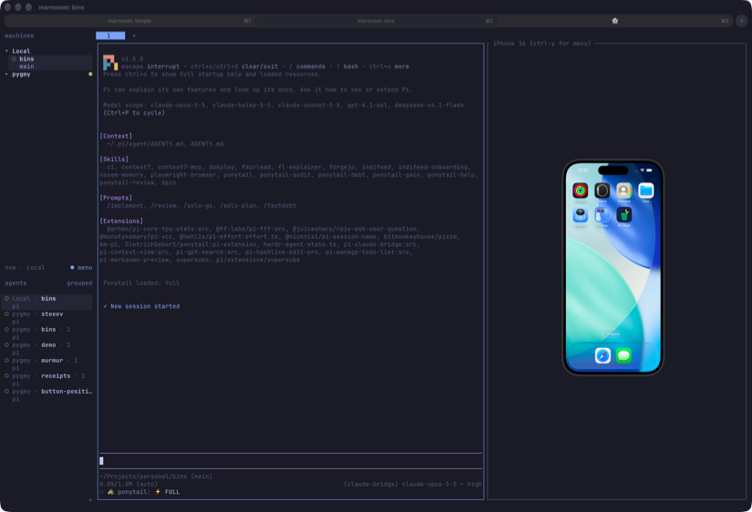
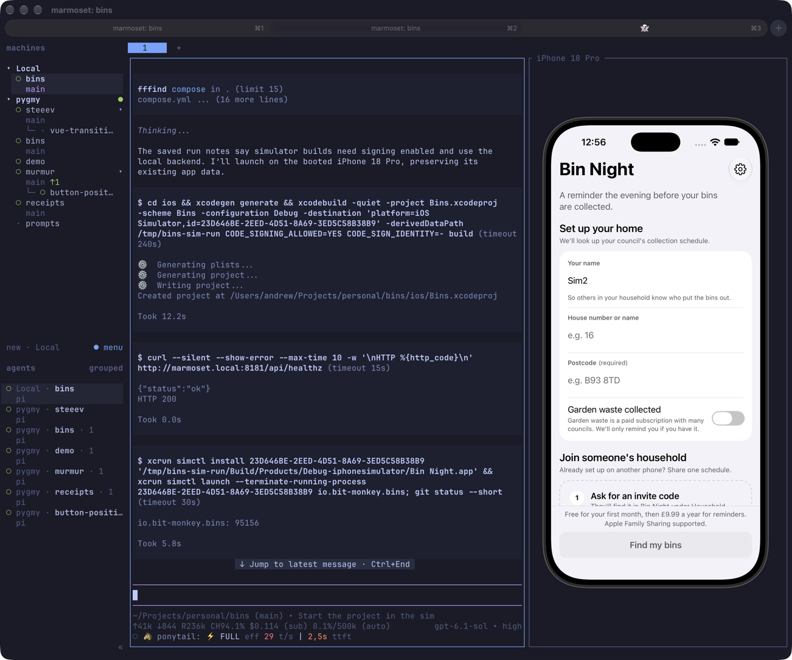

# pisim

A [pi](https://pi.dev) extension for iOS development: show a booted iOS Simulator inside a [herdr](https://herdr.dev) pane and drive it with your mouse and keyboard, and give the agent tools to see the simulator's screen, tap, type, press buttons and launch apps.

- **`/sim`** opens the simulator in a pane next to pi, in its device bezel. The pane updates only when the screen changes (no CPU while it's still) and runs at the simulator's frame rate while it moves.
- Click to tap, drag to swipe or scroll, type to type. Input lands in about 0.1 s.
- The agent gets `sim_screenshot`, `sim_describe`, `sim_tap`, `sim_type`, `sim_button`, `sim_fold`, `sim_launch` and `sim_open_url`.

## Requirements

- macOS with **Xcode 27 or later**. Input uses Xcode 27's simulator HID service; tested with Xcode 27.1 and iOS 26.2, 27.0 and 27.1 simulators.
- A **booted** iOS simulator.
- For the `/sim` viewer: pi running inside **herdr**, in a terminal that supports the Kitty graphics protocol, such as Ghostty, kitty or WezTerm. The agent tools work without herdr.

There is nothing else to install. The extension builds a small native helper with Xcode's `clang` the first time it needs it.

## Install

```bash
pi install npm:@bitmonkey/pisim
```

or from git:

```bash
pi install git:github.com/bitmonkeyhouse/pisim
```

## The viewer

Run `/sim` in pi, optionally with a simulator's name or UDID (`/sim iPhone 16`). With several booted and no name given, pisim asks which one. It splits your herdr pane and shows the simulator on the right at its real physical size, as Simulator.app's Physical Size, worked out from the dimensions of the display the terminal is on; move the window to another display and it resizes to match. If the pane is too small for that, the device shrinks to fit. When the device turns or a foldable opens and no longer fits, the pane widens, and goes back to its old width once the device fits again (unless you've resized it yourself in between, or zoomed with Ctrl-Y `z`).

| In the pane | Does |
|---|---|
| Click | Tap |
| Drag | Swipe or scroll; long-presses and flicks work too |
| Type | Types into the focused field; Enter, Backspace, Tab, Esc and arrows work |
| Ctrl-Y, then `h` / `l` / `s` / `+` / `-` | Home, Lock (again to wake), Siri, volume up / down |
| Ctrl-Y, then `r` or `→` / `←` | Rotate the device clockwise / anticlockwise |
| Ctrl-Y, then `z` | Zoom to fill the pane, or back to actual size |
| Ctrl-Y, then `o` / `c` / `p` / `f` | On a foldable (iPhone Duo): open, close, half-fold, or toggle open and closed |
| Ctrl-C | Close the pane |

Click the pane first so it has your keyboard. The scroll wheel goes to herdr, not the simulator, so drag to scroll. Typing follows the simulator's hardware keyboard layout: US, or British for `en_GB` simulators.

## Agent tools

Every tool takes an optional `device` (name or UDID). Without it, the tools use the simulator opened with `/sim`, or the only booted one.

| Tool | Does |
|---|---|
| `sim_screenshot` | Returns the screen as an image |
| `sim_describe` | Lists the on-screen accessibility elements, one per line: type, label, id, value and frame in points |
| `sim_tap` | Taps an element by accessibility `label` or `id` (waiting up to 3 s for it), or a point `x`,`y` in points |
| `sim_type` | Types text into the focused field |
| `sim_button` | Presses `home`, `lock`, `siri`, `volume-up` or `volume-down` |
| `sim_fold` | Folds an iPhone Duo `open`, `closed` or `partial`, and waits until the matching display is in use |
| `sim_launch` | Launches an app by bundle id, optionally restarting it |
| `sim_open_url` | Opens a URL or deep link |

## How it works

The TypeScript side is the pi extension (`index.ts`), the viewer that runs in the herdr pane (`viewer.ts`) and the bezel layout (`bezel.ts`). The native side is one Objective-C file, `simhelper.m`, built into a `simhelper` binary next to it on first use:

- **`hid`** keeps one connection open to the simulator's input service (`dtuhidd`) and sends touches, keys and buttons. A fresh connection costs about 0.5 s; this one is opened once.
- **`video`** follows the simulator's display buffer and its frame callbacks, scales each new frame on the GPU with Metal, and hands it to the terminal as raw pixels through the Kitty graphics protocol. It does nothing while the screen is still.
- **`describe`** reads the accessibility tree on the Mac, as Simulator.app does.
- **`bezel`** renders the device frame from Xcode's DeviceKit artwork.

These use private Apple frameworks (CoreSimulator, AccessibilityPlatformTranslation), as other simulator automation tools do, so a future Xcode may break them.

## Limitations

- Single touch only: no pinch or two-finger gestures. Long hardware button presses aren't supported.
- Only US and British keyboard layouts are mapped; characters outside the layout (é, emoji) can't be typed.
- Tested on iPhones and the iPhone Duo. The viewer and the agent tools follow whichever of the Duo's displays is lit; Xcode only has a bezel for the outer one, so the inner one gets that frame stretched to fit.
- The viewer starts the device in portrait. While it's rotated, `sim_tap` by `x`,`y` or by label taps in the wrong place: the agent tools don't know the device has turned.

## Credits

`simhelper` follows the approach of Meta's [idb](https://github.com/facebook/idb) (MIT) for the simulator's input connection, framebuffer and accessibility; see [NOTICE](NOTICE).

## Licence

MIT. See [LICENSE](LICENSE).
